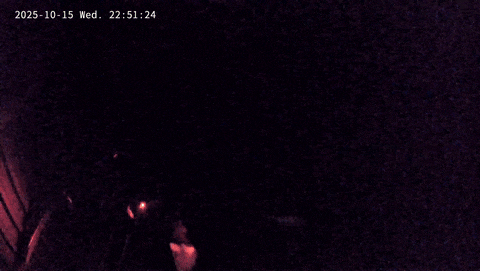
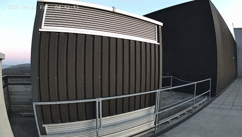

# Alpaca Rolling Roof Enclosure

Custom Arduino Opta PLC controller for rolling roof observatory automation that controls the roof shutter via a Variable Frequency Drive (VFD) motor controller.

<p align="center">
    
</p>

<p align="center">
    
</p>


## Purpose

This PLC acts as an automated rolling roof controller that:
- Tracks roof position via fully open/closed proximity sensors
- Controls roof movement through RS-485 Modbus communication with a VFD motor (OMRON 3G3M1-AB007, 3-PH 1HP 80-B4-B14-2 0.75kW, 1:100 gear box, MIG encoder 120-19-4-7)
- Monitors a safety relay for emergency stop conditions (OMRON G9SE-201)
- Exposes an ASCOM Alpaca Dome API for roof control

## How It Works

The PLC continuously monitors sensor inputs and provides motor control through two communication channels:

### Sensor Inputs
1. **Fully Closed Sensor** (A5): Detects when roof is completely closed (HIGH when closed, interrupt-driven)
2. **Fully Open Sensor** (A4): Detects when roof is completely open (HIGH when open, interrupt-driven)
3. **Safety Relay** (A6): Emergency stop relay (LOW = activated/error, HIGH = normal, interrupt-driven)

### Motor Control (via RS-485 Modbus RTU)
- Communicates with VFD (Variable Frequency Drive) motor controller
- Uses Modbus RTU protocol at 9600 baud, Station ID 1
- Sets motor frequency to 15 Hz (1500 = 15.00 Hz in VFD units)
- Controls direction through digital outputs D0 (close) and D2 (open)

### Shutter Logic

The shutter status is calculated on each request from the motor direction and the sensors:
- **shutterOpen** (0): Motor stopped and fully open sensor active
- **shutterClosed** (1): Motor stopped and fully closed sensor active
- **shutterOpening** (2): Motor driving toward open (set as soon as `openshutter` returns)
- **shutterClosing** (3): Motor driving toward closed (set as soon as `closeshutter` returns)
- **shutterError** (4): Safety relay activated, both limit sensors active, a motor timeout (see below), or motor stopped between the limits (position unknown, for example after `abortslew`)

**Safety Behavior:**
- **External Control**: Opening/closing commands come from the master PLC or OCS, which monitors overall observatory safety
- Safety relay activation immediately stops all movement and sets error state
- Proximity sensors automatically stop movement when limits are reached. A limit sensor only stops the motor when it drives toward that limit, so a bouncing sensor cannot stop a move away from it
- The main loop also checks the limits and the safety relay on each pass, as a backup for a missed interrupt
- **No start timeout** (`NO_START_TIMEOUT`, 10 s): if the roof started at a limit and that sensor is still active after this time, the motor is stopped. This stops a VFD that did not start from starting the roof minutes later
- **Travel timeout** (`TRAVEL_TIMEOUT`, 135 s): if a move does not reach its limit sensor in this time, the motor is stopped. This covers a failed limit sensor or a jam
- After a timeout the shutter status is `shutterError` until the next open or close command. Timeouts do not block commands, so the master PLC can always close the roof
- `openshutter`, `closeshutter` and `park` return an ASCOM error (0x500) if the safety relay is activated or both limit sensors are active
- Commands are accepted when the device is not connected, because the master PLC sends `closeshutter` without connecting first
- Direction LEDs (D0, D2) indicate current movement direction

### Network Architecture

The PLC hosts an ASCOM Alpaca API at `http://192.168.1.14/` providing:
- **Dome Control** endpoints: `/api/v1/dome/0/`
- **Management** endpoints: `/management/`
- **Discovery**: answers Alpaca discovery broadcasts on UDP port 32227

The controller exposes the standard ASCOM Alpaca Dome interface, allowing integration with observatory automation software. **Note**: Overall observatory safety decisions, if OCS fails, are made by the master PLC (192.168.1.10), which controls when this roof should open or close based on weather conditions and other factors.

## Hardware Setup

### Controller
- **Arduino Opta PLC** with Ethernet connection

### Sensor Connections (Analog Inputs)
- **A4**: Fully open proximity sensor (HIGH when roof fully open)
- **A5**: Fully closed proximity sensor (HIGH when roof fully closed)
- **A6**: Safety relay input (LOW = emergency stop activated)

### Motor Control (Digital Outputs)
- **D0**: Close direction signal to VFD
- **D2**: Open direction signal to VFD
- **LED_D0**: Close direction indicator LED
- **LED_D2**: Open direction indicator LED

### RS-485 Modbus Connection
- Connect Opta's RS-485 terminals to VFD motor controller
- **Baud Rate**: 9600
- **Parity**: None
- **Stop Bits**: 1
- **VFD Station ID**: 1
- **Frequency**: Set to 15 Hz for roof operation

## Compilation & Upload

Requires [arduino-cli](https://arduino.github.io/arduino-cli/) installed with the Arduino Mbed Opta core (custom core: https://github.com/ppp-one/ArduinoCore-mbed, or use the default Arduino Mbed core, however HTTP queries will be slower with the default core).

```bash
# Compile (adjust FQBN to your installed core)
arduino-cli compile --fqbn arduino-git:mbed:opta ./

# Upload to Opta PLC (replace port as needed)
arduino-cli upload -p /dev/cu.usbmodem2101 --fqbn arduino-git:mbed:opta ./
```

## Configuration

### Network Settings
Edit the IP address in `alpaca-rolling-enclosure.ino`:
```cpp
byte ip[] = {192, 168, 1, 14}; // PLC's IP address
```

The MAC address is automatically read from the Opta board's built-in memory.

### Motor Settings
VFD frequency is configured in the `setup()` function:
```cpp
// Set frequency to 15 Hz (1500 = 15.00 Hz in VFD units)
ModbusRTUClient.holdingRegisterWrite(SLAVE_ID, FIRST_FREQUENCY_REGISTER, 1500);
ModbusRTUClient.holdingRegisterWrite(SLAVE_ID, FREQUENCY_REGISTER, 1500);
```

Adjust the frequency value (1500) if your roof requires different motor speeds. The value represents frequency × 100 (e.g., 2000 = 20.00 Hz).

### Modbus Parameters
If your VFD uses different settings, modify these constants:
```cpp
const int SLAVE_ID = 1;               // VFD Station ID
const long BAUD_RATE = 9600;          // Communication speed
const int RESPONSE_TIMEOUT = 2000;    // Timeout in milliseconds
```

## ASCOM Alpaca API

The controller implements the ASCOM Alpaca Dome device (interface version 3) at `http://192.168.1.14/api/v1/`.

### Common Endpoints

| Endpoint | Method | Description |
|----------|--------|-------------|
| `connected` | GET/PUT | Connection state (PUT needs `Connected=true\|false`) |
| `connect`, `disconnect` | PUT | Connect or disconnect (completes at once) |
| `connecting` | GET | Always false |
| `name`, `description`, `driverinfo`, `driverversion` | GET | Device information |
| `interfaceversion` | GET | 3 |
| `supportedactions` | GET | Empty list |
| `devicestate` | GET | Operational state in one call |
| `action`, `commandblind`, `commandbool`, `commandstring` | PUT | Not implemented (error 0x40C / 0x400) |

**Note**: Observatory safety decisions are handled by the master PLC (192.168.1.10), which hosts the safety monitor. This controller focuses on roof movement and limit detection.

### Dome Endpoints

#### Status & Capabilities
| Endpoint | Method | Description |
|----------|--------|-------------|
| `/dome/0/atpark` | GET | Returns true if roof is closed |
| `/dome/0/shutterstatus` | GET | Roof status (0-4: open, closed, opening, closing, error) |
| `/dome/0/slewing` | GET | Returns true if roof is moving |
| `/dome/0/slaved` | GET | Always false |
| `/dome/0/canpark` | GET | Returns true (park closes the roof) |
| `/dome/0/cansetshutter` | GET | Returns true (roof can be controlled) |
| `/dome/0/canfindhome`, `cansetaltitude`, `cansetazimuth`, `cansetpark`, `canslave`, `cansyncazimuth` | GET | Return false |
| `/dome/0/altitude`, `azimuth`, `athome` | GET | Not implemented (error 0x400) |

#### Control Commands
| Endpoint | Method | Description |
|----------|--------|-------------|
| `/dome/0/openshutter` | PUT | Open the roof (starts opening if not already open) |
| `/dome/0/closeshutter` | PUT | Close the roof (starts closing if not already closed) |
| `/dome/0/park` | PUT | Park the roof (same as close) |
| `/dome/0/abortslew` | PUT | Stop all roof movement immediately |
| `/dome/0/findhome`, `setpark`, `slewtoaltitude`, `slewtoazimuth`, `synctoazimuth`, `slaved` | PUT | Not implemented (error 0x400) |

### Management Endpoints

| Endpoint | Method | Description |
|----------|--------|-------------|
| `/management/apiversions` | GET | `[1]` |
| `/management/v1/description` | GET | Server description |
| `/management/v1/configureddevices` | GET | The dome |

### Parameters
GET parameters are read from the query string and PUT parameters from the form body. Parameter names are case insensitive, as the Alpaca specification requires. `ClientTransactionID` is returned in every response.

### Response Format
All responses follow ASCOM JSON format. `Value` is only present for properties:
```json
{
  "ClientTransactionID": 0,
  "ServerTransactionID": 1,
  "ErrorNumber": 0,
  "ErrorMessage": "",
  "Value": <result>
}
```

Unknown endpoints return HTTP 400.

## Safety Features

### Watchdog Timer
- 20-second watchdog timer ensures the system resets if code hangs
- Timer is "kicked" (reset) in every loop iteration
- Provides automatic recovery from software faults

### Interrupt-Driven Sensors
The limit sensors and the safety relay use hardware interrupts (`CHANGE` mode) for immediate response:
- **Proximity sensors**: Stops motor immediately when the limit it drives toward is reached
- **Safety relay**: Emergency stop with instant motor halt

### Hardware Safety Relay
The safety relay (A6) provides a fail-safe mechanism:
- When activated (LOW), immediately stops all movement
- Sets shutter status to error state
- Refuses open and close commands until the relay is released
- Can be connected to external e-stop buttons or safety systems

### Movement Protection
- Roof won't open if already fully open (checked via sensor)
- Roof won't close if already fully closed (checked via sensor)
- Proximity sensors automatically stop movement at limits
- Direction outputs are mutually exclusive: the inactive output is released first, and a reversal stops the motor for 500 ms before it drives the other way

## Maintenance

### Regular Checks
1. **Sensor Alignment**: Verify proximity sensors reliably detect open/closed positions
2. **Master PLC Communication**: Ensure the master PLC (192.168.1.10) can successfully send open/close commands
3. **Modbus Communication**: Check serial output for VFD communication errors
4. **LED Indicators**: Observe D0/D2 LEDs to confirm proper direction signaling

### Troubleshooting

**Roof won't move:**
- Check safety relay status (A6 should be HIGH)
- Verify VFD is powered and responding to Modbus commands
- Check serial monitor for "Failed to start Modbus RTU Client!" error
- Confirm proximity sensors aren't both triggered simultaneously

**Roof won't stop at limits:**
- Check proximity sensor wiring and positioning
- Verify sensors are triggering interrupts (test with serial debug)
- Ensure sensors provide stable HIGH signal when activated

**"Ethernet failed, restarting" message:**
- The PLC restarts if it has no Ethernet link 10 seconds after boot, and tries again
- Verify Ethernet cable connection
- Check MAC address is being read correctly from Opta memory
- Confirm IP address doesn't conflict with other network devices

**Modbus errors:**
- Check RS-485 wiring (A/B terminals correctly connected)
- Verify VFD station ID matches `SLAVE_ID` constant
- Confirm VFD baud rate is set to 9600
- Check for proper RS-485 termination if cable is long

**Watchdog resets:**
- If system resets frequently, the main loop may be blocking
- Check for network requests that take longer than 20 seconds
- Increase `WATCHDOG_TIMEOUT` if necessary (currently 20000 ms)

### Serial Monitor
Connect to the Opta via USB and open serial monitor at 9600 baud to see:
- IP address assignment confirmation
- Modbus initialization status
- Frequency setting confirmations
- Any Modbus communication errors
- Incoming HTTP request paths (only when `DEBUG` is set to `true`; Serial writes can block while a host has the USB port open but does not read it)

## Integration Examples

### Python with alpyca
```python
from alpaca.dome import Dome

dome = Dome('192.168.1.14:80', 0)
dome.Connected = True

# Open the roof
dome.OpenShutter()

# Wait for completion
while dome.Slewing:
    time.sleep(1)

# Close the roof
dome.CloseShutter()
```
## Code Structure for Developers

### Main Components

**Global Variables:**
- `motorDirection`: Stopped, opening or closing. The sensors are read directly when needed
- `motorStartTime`, `motorStartedAtLimit`, `motorFault`: State for the motor timeouts
- `domeConnected`: ASCOM connected state. Starts as connected after a reboot

**Key Functions:**
- `open_shutter()`: Activates open direction output (D2), returns an error message if it cannot
- `close_shutter()`: Activates close direction output (D0), returns an error message if it cannot
- `stop_shutter()`: Deactivates both direction outputs
- `shutter_status()`: Calculates the ASCOM shutter status
- `check_limits()`: Polled backup for the interrupts, and the motor timeouts
- `domeEndPoint()`: Handles the ASCOM Alpaca dome requests
- `handle_discovery()`: Answers Alpaca discovery broadcasts

**Interrupt Service Routines (ISRs):**
- `fullyOpenSensorISR()`: Stops motor when fully open while opening
- `fullyClosedSensorISR()`: Stops motor when fully closed while closing
- `safetyRelayISR()`: Emergency stop on relay activation

**Setup Process:**
1. Set the direction outputs low
2. Initialize serial communication (9600 baud)
3. Start watchdog timer (20s)
4. Configure sensor input pins and attach hardware interrupts
5. Configure Ethernet with MAC from board memory (restart if no link within 10s)
6. Register ASCOM Alpaca and management routes
7. Start Ethernet server on port 80 and discovery on UDP port 32227
8. Initialize Modbus RTU client
9. Set VFD frequency to 15 Hz

**Main Loop:**
1. Check the limits and the safety relay
2. Answer discovery broadcasts
3. Check for incoming Ethernet clients
4. Process HTTP requests through aWOT framework
5. Kick watchdog timer
6. Repeat

### Adding New Features

**To add a new sensor:**
1. Define pin constant (e.g., `constexpr int newSensorPin = A7;`)
2. Configure pin in `setup()`: `pinMode(newSensorPin, INPUT);`
3. Read it with `digitalRead()` where it is needed
4. If it must act at once, write a short ISR and attach it after `pinMode()`: `attachInterrupt(digitalPinToInterrupt(newSensorPin), newSensorISR, CHANGE);`. Do not use `Serial` or allocate memory in an ISR

**To modify VFD parameters:**
- Locate Modbus register addresses in your VFD manual
- Update `FIRST_FREQUENCY_REGISTER`, `FREQUENCY_REGISTER`, or add new register constants
- Use `ModbusRTUClient.holdingRegisterWrite()` or `.coilWrite()` in `setup()` or control functions

**To add custom endpoints:**
1. Add a handler and register it in `setup()` before `app.use(&badRequest)`: `app.get("/custom/endpoint", &customHandler);`
2. End the handler with `res.end()`, otherwise the 400 fallback also runs
3. To add a dome member, add a branch in `domeEndPoint()`

## License

MIT License - see [LICENSE](LICENSE)
 
